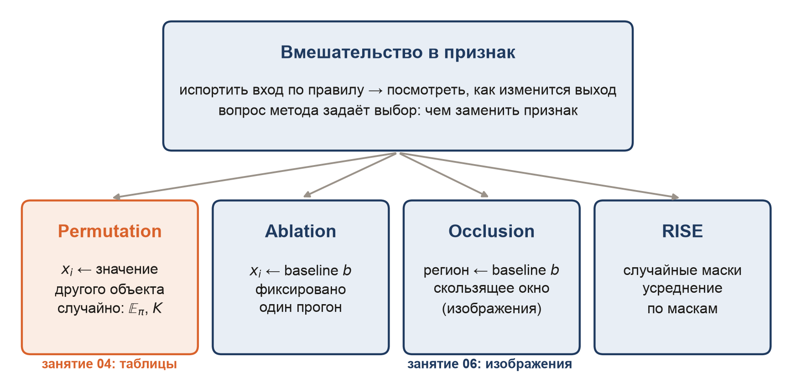

# Занятие 04. Model-agnostic методы: якоря и контрфактуалы, CPO, ICE, PDP, ALE, permutation importance

Презентация — в чате курса. Код всех примеров — [demo_04_global_model_agnostic.ipynb](demo_04_global_model_agnostic.ipynb): там же подробная теория, псевдокод и нюансы методов.

## Темы
1. Якоря и контрфактуалы: чего достаточно для решения и что надо изменить.
2. CPO и ICE: что будет с прогнозом одного объекта и всех объектов; d-ICE.
3. PDP: среднее ICE-кривых.
4. ALE и взаимодействия: эффект признака без выдуманных объектов; 2D PDP и H-статистика.
5. Permutation importance: три записи, число перестановок, LOCO, дисбаланс категорий, пограничные случаи, разные модели — разная важность.

**Post-hoc, model-agnostic метод** — объясняет уже обученную модель снаружи и использует только `predict`.

---

## 1. Якоря и контрфактуалы

**Anchors** (Ribeiro, Singh, Guestrin, 2018) — правило $A$ на признаки объекта, при котором прогноз почти наверняка не меняется:
$$\mathrm{prec}(A) = P\big(f(z) = f(x) \mid A(z)\big) \ge \tau, \qquad \mathrm{cov}(A) = P\big(A(z)\big);$$
ищут правило с наибольшим покрытием при достаточной точности.

**Контрфактуал** (Wachter, Mittelstadt, Russell, 2018) — ближайшая точка с другим решением:
$$x' = \arg\min_{x'} d(x, x') \;\; \text{при} \;\; f(x') = y', \qquad d(x, x') = \sum_j \frac{|x_j - x'_j|}{\mathrm{MAD}_j}.$$
Требования к контрфактуалу: близость, actionability, plausibility, sparsity, diversity (DiCE, Mothilal et al., 2020).

**Нюансы и границы.**
- Якорь отвечает на вопрос достаточности, контрфактуал — ближе к необходимости (занятие 01; проверка — блок IV).
- Точность и покрытие якоря тянут в разные стороны; точность зависит от выбора окрестности.
- Ближайший контрфактуал не обязательно полезен: он может менять неизменяемые признаки. Выбор между контрфактуалами — ценностное решение.
- Оба описывают модель, а не мир.

## 2. CPO и ICE

**Ceteris-paribus профиль** (Biecek & Burzykowski, 2021) — «что, если» для одного объекта: меняем признак $j$ на $z$, остальные оставляем как у объекта; $x_i^{z}$ — объект $x_i$ с $j$-м признаком, равным $z$:
$$\mathrm{CPO}(x_i, j):\; z \mapsto f(x_i^{z}).$$
**Осцилляции (CPO)** — локальная важность признака для объекта:
$$O_j(x_i) = \mathbb E_{z}\big|f(x_i^{z}) - f(x_i)\big| = \int \big|f(x_i^{z}) - f(x_i)\big|\, g^j(z)\, dz,$$
где $g^j$ — плотность признака. На практике интеграл заменяют средним по равномерной сетке из $k$ точек или по $n$ наблюдаемым значениям признака. Интегральная запись иногда полезна сама по себе: она показывает, что оценка зависит от веса $g^j$, и его можно выбрать явно (например, только правдоподобные для объекта значения); для простой модели интеграл считается точно — у линейной модели $O_j(x_i) = |w_j|\, \mathbb E|z - x_{ij}|$.

**ICE** (Goldstein et al., 2015) — CP-профили всех объектов:
$$\mathrm{ICE}_i(v) = f(v, x_{i,C}), \qquad \text{c-ICE}_i(v) = \mathrm{ICE}_i(v) - \mathrm{ICE}_i(v_0).$$

**d-ICE** — производная ICE-кривой: $\mathrm{dICE}_i(v) = \partial f(v, x_{i,C}) / \partial v$. Без взаимодействий все d-ICE-кривые совпадают.

**Нюансы и границы.**
- Осцилляции — локальная важность: у другого объекта порядок признаков другой; направления эффекта они не показывают и не складываются в прогноз.
- Параллельные ICE-кривые — эффект одинаков у всех; расходящиеся — эффект зависит от других признаков.
- Разброс d-ICE — признак взаимодействия; у деревьев ICE ступенчатые, и производную приходится сглаживать.
- При коррелированных признаках CPO и ICE экстраполируют: подставленное значение может не встречаться вместе с остальными признаками объекта.

## 3. PDP

**PDP** (Friedman, 2001) — среднее ICE-кривых, то есть усреднение CP-профилей по объектам:
$$\mathrm{PD}_j(v) = \mathbb E_{X_C}\big[f(v, X_C)\big] \approx \frac1n \sum_i \mathrm{ICE}_i(v).$$

**Нюансы и границы.**
- PDP предполагает, что признак независим от остальных. Иначе она усредняет прогнозы модели на объектах, которых не бывает.
- Если ICE-кривые расходятся, PDP прячет разброс; ровная PDP может быть средним кривых противоположного знака.
- Для классификации указывайте, что по оси Y: вероятность или логит.

## 4. ALE и взаимодействия

### ALE

**M-plot** — среднее прогнозов объектов с $x_j \approx v$: без экстраполяции, но со смешением эффектов коррелированных признаков.

**ALE** (Apley & Zhu, 2020) — накопленные средние разности прогнозов внутри интервалов $(z_{k-1}, z_k]$:
$$\Delta_k = \frac{1}{n_k} \sum_{i:\, x_{ij} \in (z_{k-1}, z_k]} \big[f(z_k, x_{i,C}) - f(z_{k-1}, x_{i,C})\big], \qquad \mathrm{ALE}(v) = \sum_{k:\, z_k \le v} \Delta_k - \text{const}.$$

**Нюансы и границы.**
- Объекты сдвигаются только внутри своего интервала — экстраполяции нет; разность при тех же остальных признаках убирает их вклад.
- При независимых признаках PDP и ALE совпадают; при коррелированных выбирайте ALE.
- Число интервалов — компромисс между грубостью и шумом.
- ALE говорит только об области, где есть данные; разброса по объектам, как у ICE, не показывает.
- Категориальным признакам нужен порядок категорий.

### Взаимодействия

**2D PDP:** $\mathrm{PD}_{jk}(v, w) = \frac1n \sum_i f(v, w, x_{i,C})$.

**H-статистика** (Friedman & Popescu, 2008) — доля эффекта пары, которую не объясняет сумма одномерных:
$$H^2_{jk} = \frac{\sum_i \big[\mathrm{PD}_{jk} - \mathrm{PD}_j - \mathrm{PD}_k\big]^2}{\sum_i \mathrm{PD}^2_{jk}}.$$

**Нюансы и границы.**
- H² мерит взаимодействие, а не корреляцию: у пары почти одинаковых признаков H² может быть около нуля.
- Большой H² при крошечном общем эффекте пары ничего не значит.
- Дорого считать — используют подвыборку; наследует экстраполяцию PDP.

## 5. Permutation importance

**Определение.** Для батча $X = \{x^1, \dots, x^n\}$ и признака $i$ строим батч $X^{\pi_i}$, в котором значения признака $i$ перемешаны случайной перестановкой $\pi$: у объекта $j$ все признаки свои, а на месте $i$-го — значение объекта $\pi(j)$:
$$X^{\pi_i} = \big\{(x^1_{-i}, x^{\pi(1)}_i), \dots, (x^n_{-i}, x^{\pi(n)}_i)\big\}, \qquad \mathrm{Perm}_i(X) = \mathbb E_\pi\big[\mathcal L(f(X^{\pi_i})) - \mathcal L(f(X))\big].$$
Модель не переобучается; маргинальное распределение признака сохраняется, связь с целью и остальными признаками рвётся. Важность — случайная величина, её усредняют по $K$ перестановкам. Метод предложил Брейман (2001) для случайного леса, Fisher, Rudin, Dominici (2019) обобщили его на любую модель.

**Метод на основе вмешательства.** Перестановка — частный случай общего класса: испортить вход по правилу и посмотреть, как изменится выход. Методы класса отличаются тем, чем заменяют признак: перестановка — значением случайного другого объекта (отсюда $\mathbb E_\pi$ и $K$), абляция — фиксированным baseline $b$, окклюзия — baseline на целом регионе изображения, RISE — случайными масками. Выбор замены задаёт вопрос, на который отвечает метод. Абляцию, окклюзию и RISE разбираем на занятии 06.

**Три записи важности** ($e$ — ошибка, $q$ — метрика качества):
$$\mathrm{MR}_i = \frac1K \sum_k \frac{e_{\mathrm{perm},k}}{e_{\mathrm{orig}}}, \qquad \mathrm{PI}_i = \frac1K \sum_k e_{\mathrm{perm},k} - e_{\mathrm{orig}}, \qquad \mathrm{PI}_i = q_{\mathrm{orig}} - \frac1K \sum_k q_{\mathrm{perm},k}.$$
- Отношение ошибок (model reliance) — исходная запись: 1 — модель не опирается на признак; $\to 2$ — без признака ошибка удваивается; $< 1$ — признак связан с другим или вносит шум.
- Разность ошибок и разность качества (так считают `sklearn` и `eli5`): $> 0$ — признак нужен, $\approx 0$ — нет.
- Внутри одной модели записи ранжируют признаки одинаково; при сравнении моделей с разным уровнем ошибки — по-разному. Указывайте, какая запись использована.

**Число перестановок.** Различных переставленных колонок $P = n!/(k_1! \cdot \ldots \cdot k_m!)$, где $k_i$ — число повторов каждого значения. Матожидание по перестановкам равно среднему по $n^2$ упорядоченным парам «объекту $j$ — значение объекта $l$»:
$$\mathbb E_\pi\big[e_{\mathrm{perm}}\big] = \frac{n-1}{n}\, e_{\mathrm{switch}} + \frac1n\, e_{\mathrm{orig}},$$
где $e_{\mathrm{switch}}$ — средняя ошибка по парам $j \ne l$. Случайная перестановка немного занижает важность (на 20% при $n = 5$, на 0,1% при $n = 1000$). Вызовов модели: $n^2$ по всем парам, $n(n-1)$ без диагонали, $\approx n$ при сравнении двух половин выборки, $K \cdot n$ в Монте-Карло библиотек. Оценка случайна — смотрят на интервал.

**Drop-column importance**, она же **LOCO** (leave-one-covariate-out; Lei et al., 2018), — признак удаляют и модель переобучают:
$$\mathrm{DC}_j = s(f, X, y) - s\big(f_{-j}, X_{-j}, y\big).$$

**Дисбаланс категорий.** Идеальная модель, MSE, бинарный признак с долей единиц $p$: важность равна удвоенной дисперсии признака,
$$\mathrm{PI} = 2p(1-p).$$
При $p = 0{,}01$ важность в 25 раз ниже, чем при $p = 0{,}5$, хотя сигнал тот же. Это смещение по построению: увеличение $K$ его не исправляет.

**Пограничные случаи.** Доля «холостых» пар, где подмена ничего не меняет, — $\sum_i k_i(k_i - 1)/(n(n-1))$.
- Константный признак: $P = 1$, важность тождественно ноль — «измерять было нечего».
- 9 против 1 при $n = 10$: $P = 10$, каждая десятая перестановка — исходная, иначе сдвигаются две строки; холостых пар 72 из 90.
- Два объекта: $P = 2$, с вероятностью 1/2 важность ноль.

**Одни данные, две модели.** $y = X_1 \text{ AND } X_2$, и $X_1 = 1 \Rightarrow X_2 = 1$. Модель A ($\hat y = X_1$) и модель B ($\hat y = X_1 \text{ AND } X_2$) одинаково точны, но важность $X_2$ у A равна 0, у B — 0,125 в среднем по всем перестановкам. Эффект Рашомона (Breiman, 2001); **model class reliance** (Fisher et al., 2019) — важность как интервал по множеству почти оптимальных моделей.

**Что делать.**
- **Условная перестановка** (Strobl et al., 2008) — значения берут из $P(X_i \mid X_{-i})$, на практике перемешивают внутри групп с похожими соседями. Обычная перестановка берёт их из $P(X_i)$. Это выбор вопроса (термины — Chen, Janizek, Lundberg, Lee, 2020):
  - *true to the model* (обычная) — объяснение описывает функцию $f$, в том числе на объектах вне данных: всё, что модель берёт из признака;
  - *true to the data* (условная) — объяснение учитывает зависимости признаков: что признак добавляет сверх соседей.
- **Групповая** — перемешать коррелированные признаки одной перестановкой.
- **LOCO** — выбросить и переобучить.
- **Corrected PIMP** (Altmann et al., 2010) — перемешивать целевую переменную, переобучать и строить нулевое распределение важности; даёт p-value.

**Нюансы и границы.**
- Считайте на тесте: на обучении PI показывает и опору на запомненный шум.
- PI говорит о конкретной модели, а не о полезности признака вообще.
- Коррелированные признаки — ошибка в обе стороны: перемешивание создаёт объекты вне данных, и PI мерит экстраполяцию; если модель опирается на одного соседа, второй получает низкую важность; если на обоих — оба высокие, хотя любой можно убрать. PI и drop-column тогда расходятся.
- Низкая важность при коррелированном соседе не значит, что признак не связан с целью.
- Сравнивать PI признаков с сильно разной частотностью некорректно.
- «Важность» — всегда ответ на конкретный вопрос: называйте метод, запись и данные.

## Общий вывод

Все методы занятия — извлечение характеристик признаков из поведения модели: якорь — правило с точностью и покрытием, контрфактуал — расстояние между векторами, CPO — осцилляция прогноза, ICE, PDP и ALE — кривая эффекта, H² — доля взаимодействия, permutation importance и LOCO — изменение метрики. Чего у них нет:

- **Аксиом к самому методу.** Единственное общее требование — центрирование (c-ICE, ALE, частные зависимости в H²). Никто не гарантирует, что вклады признаков сложатся в прогноз и что неиспользуемый признак получит ноль. Требования к методу как аксиомы — SHAP, занятие 05.
- **Расчёта на DL и не-табличные данные.** Методы много раз «шатают» отдельные признаки и вызывают модель; для нейросетей это дорого, а пиксель или токен сам по себе мало что значит. Исключение — перестановка: она переносится на DL как метод на основе вмешательства, занятие 06.

## Какой метод на какой вопрос

| Метод | Вопрос | Ломается, когда |
|---|---|---|
| Anchors | чего достаточно, чтобы решение осталось | маленькое покрытие; выбор окрестности |
| Контрфактуал | что изменить, чтобы решение поменялось | много вариантов; изменяемость признаков |
| CPO, осцилляции | что будет с прогнозом одного объекта | экстраполяция; локально |
| ICE, d-ICE | как зависит прогноз каждого объекта | те же экстраполяции; много кривых трудно читать |
| PDP | как в среднем прогноз зависит от признака | признаки коррелированы; среднее прячет разброс |
| ALE | локальный эффект там, где есть данные | нет разброса по объектам; выбор интервалов |
| 2D PDP, H² | есть ли взаимодействие пары | дорого; H² ≠ сила эффекта |
| Permutation importance | насколько модели нужен признак | признаки коррелированы; редкие категории; мало различных значений |
| Drop-column (LOCO) | что будет без признака, если переучить | дорого; коррелированный сосед подхватывает |

## Литература
- Biecek P., Burzykowski T., Explanatory Model Analysis, Chapman & Hall/CRC, 2021 — главы Ceteris-paribus Profiles и Ceteris-paribus Oscillations.
- Goldstein A., Kapelner A., Bleich J., Pitkin E., Peeking inside the black box: visualizing statistical learning with plots of individual conditional expectation, JCGS, 2015.
- Friedman J. H., Greedy function approximation: a gradient boosting machine, Annals of Statistics, 2001.
- Apley D. W., Zhu J., Visualizing the effects of predictor variables in black box supervised learning models, JRSS B, 2020.
- Friedman J. H., Popescu B. E., Predictive learning via rule ensembles, Annals of Applied Statistics, 2008.
- Breiman L., Random forests, Machine Learning, 2001.
- Fisher A., Rudin C., Dominici F., All models are wrong, but many are useful: learning a variable's importance by studying an entire class of prediction models simultaneously, JMLR, 2019.
- Lei J., G'Sell M., Rinaldo A., Tibshirani R. J., Wasserman L., Distribution-free predictive inference for regression, arXiv:1604.04173 — LOCO.
- Strobl C. et al., Conditional variable importance for random forests, BMC Bioinformatics, 2008.
- Altmann A., Toloşi L., Sander O., Lengauer T., Permutation importance: a corrected feature importance measure, Bioinformatics, 2010.
- Chen H., Janizek J. D., Lundberg S., Lee S.-I., True to the model or true to the data?, arXiv:2006.16234, 2020.
- Hooker G., Mentch L., Zhou S., Unrestricted permutation forces extrapolation: variable importance requires at least one more model, or there is no free variable importance, Statistics and Computing, 2021.
- Ribeiro M. T., Singh S., Guestrin C., Anchors: high-precision model-agnostic explanations, AAAI 2018.
- Wachter S., Mittelstadt B., Russell C., Counterfactual explanations without opening the black box: automated decisions and the GDPR, Harvard Journal of Law & Technology, 2018.
- Mothilal R. K., Sharma A., Tan C., Explaining machine learning classifiers through diverse counterfactual explanations, FAT* 2020.
- Ustun B., Spangher A., Liu Y., Actionable recourse in linear classification, FAT* 2019.
- Molnar C., Interpretable Machine Learning, 3rd ed., 2025.
- Gkolemis V. et al., Effector: a Python package for regional explanations, arXiv:2404.02629, 2024.
